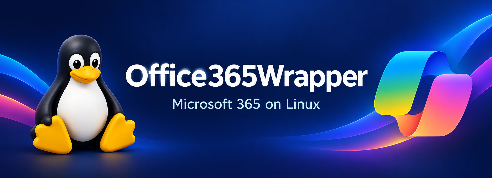

# Office365Wrapper



A Linux desktop shell for [Microsoft 365](https://www.microsoft365.com/) and
Outlook on the web, built with Rust/Tauri and WebKitGTK.

## Requirements

- Linux with a graphical desktop, Rust and Cargo, and WebKitGTK development libraries
- An internet connection and a Microsoft account or eligible organizational account

On Debian/Ubuntu, install the Linux build dependencies:

```sh
sudo apt install build-essential libwebkit2gtk-4.1-dev libayatana-appindicator3-dev \
  librsvg2-dev libxdo-dev libssl-dev
```

## Build and run

WebKitGTK uses the desktop's native Wayland or X11 backend; Chromium's
`--ozone-platform` and `--disable-vulkan` options do not apply.

```sh
cargo build --release --manifest-path src-tauri/Cargo.toml
./src-tauri/target/release/office-dashboard
```

This builds a native executable using the system WebKitGTK libraries.
If the project filesystem cannot support Cargo's build files, set
`CARGO_TARGET_DIR` to a directory on a local filesystem before building.

### AppImage

Install `patchelf` and the GStreamer plugins needed for media playback on the
build system (for example, `gstreamer1.0-plugins-base` and
`gstreamer1.0-plugins-good` on Debian/Ubuntu). Then install the Tauri CLI and
build the portable bundle:

```sh
cargo install tauri-cli --version "^2" --locked
cargo tauri build --bundles appimage
```

The AppImage is created under `src-tauri/target/release/bundle/appimage/`
(or under `CARGO_TARGET_DIR` if set). Make it executable and launch it, for
example on x86-64:

```sh
chmod +x "src-tauri/target/release/bundle/appimage/Office Dashboard_0.1.0_amd64.AppImage"
"src-tauri/target/release/bundle/appimage/Office Dashboard_0.1.0_amd64.AppImage"
```

The bundle includes the application icon, WebKitGTK dependencies, and available
GStreamer media plugins. AppImages may need FUSE 2; if FUSE is unavailable, pass
`--appimage-extract-and-run` to the AppImage instead. Desktop-menu integration
depends on the desktop environment or an AppImage integration tool.

Build on the oldest Linux distribution you intend to support: an AppImage
built on a newer system may not run on older systems because of glibc
compatibility. Rebuild the AppImage to pick up WebKitGTK security updates.

The Office Dashboard opens by default and provides shortcuts to Microsoft 365,
Outlook, OneDrive, Word, Excel, PowerPoint, OneNote, Copilot, and To Do on the web. These
web apps require internet access and may require sign-in or an eligible license.
Use **Navigate > Office Dashboard** to return to it.

Use the **Navigate** menu to switch between Microsoft 365, Outlook for work,
school, or personal accounts. Switching pages may discard unsaved changes.

To open an app directly instead:

```sh
# Microsoft 365
./src-tauri/target/release/office-dashboard --microsoft365

# Work or school account
./src-tauri/target/release/office-dashboard --outlook

# Personal Outlook.com, Hotmail, or Live account
./src-tauri/target/release/office-dashboard --outlook-personal
```

Mail and calendar are provided by the Outlook website; the shell does not
provide native mail synchronization.

## Graph search setup

The Office Dashboard can search mail, calendar events, and accessible OneDrive and
SharePoint files using Microsoft Graph. This search API supports work or school
accounts in the global Microsoft cloud, not personal Microsoft accounts.

1. [Register an app in Microsoft Entra ID](https://learn.microsoft.com/entra/identity-platform/quickstart-register-app) for organizational accounts.
2. Under **Authentication**, add the **Mobile and desktop applications**
   platform with redirect URI `http://localhost`, and enable public client flows.
3. Under **API permissions**, add delegated Microsoft Graph permissions
   `Mail.Read`, `Calendars.Read`, and `Files.Read.All`. Your organization may
   require administrator consent.
4. Set `OFFICE365_CLIENT_ID` to the app's **Application (client) ID** before
   starting the app (no client secret):

   ```sh
   export OFFICE365_CLIENT_ID="your-client-id"
   ./src-tauri/target/release/office-dashboard
   ```

Enter a query in the Office Dashboard and sign in through the system browser when
prompted. Graph sign-in is separate from website sign-in. Search returns up to
25 results per category, with errors shown per category; some results may not
include a direct link. Microsoft Search indexes the user's own mailbox and
primary calendar, not delegated mailboxes or To Do tasks. The app keeps Graph
tokens in memory only. **Sign out of Graph** clears that in-memory account but
does not sign out the browser or Microsoft websites. In the Tauri app, an
expired token requires another sign-in, and an unfinished sign-in times out
after five minutes.

## Sign in

Select **Sign in** on the Microsoft 365 or Outlook page and follow
Microsoft's prompts, including any required multifactor authentication. Sign
out or switch accounts using the website's account menu.

The Tauri app stores its WebKit profile and sign-in cookies in
`~/.local/share/com.office365wrapper.dashboard/webkit` (or under
`$XDG_DATA_HOME`). It does not import cookies from previous versions, so sign in
again after switching. The shell does not collect passwords. Organizational
policies may restrict sign-in from embedded browsers.

## Notifications

Select **Notifications > Enable Microsoft website notifications for this
session**, then use **Navigate > Reload** and enable notifications in Outlook
if prompted. Notifications require OS notification permission and depend on
the website. Permission is enabled only while a Microsoft 365 or Outlook page is
the top-level page and resets when the app exits. WebKitGTK does not expose
the requesting frame's origin in notification permission requests, so embedded
frames on those pages may also receive permission. Reloading may discard unsaved
changes. Background delivery while a different page is open is not guaranteed;
closing the window exits the app.

Microsoft pages can open HTTPS links (including app-launcher links) and
`about:blank` popups in separate WebKit windows. Other sites cannot open
new windows, and insecure navigation is blocked. Popup windows close with their
opener. Camera, microphone, and other website permissions remain blocked.
Closing all windows exits the app.
